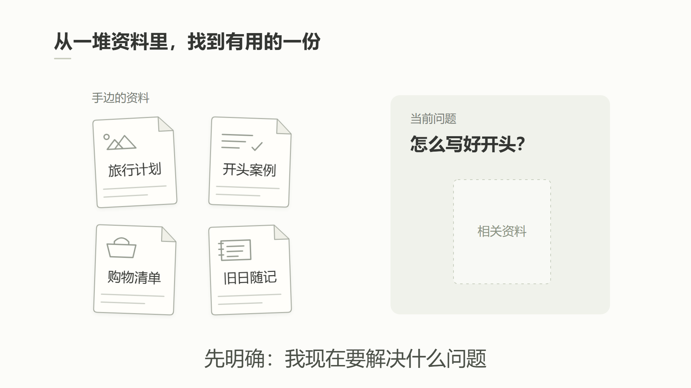
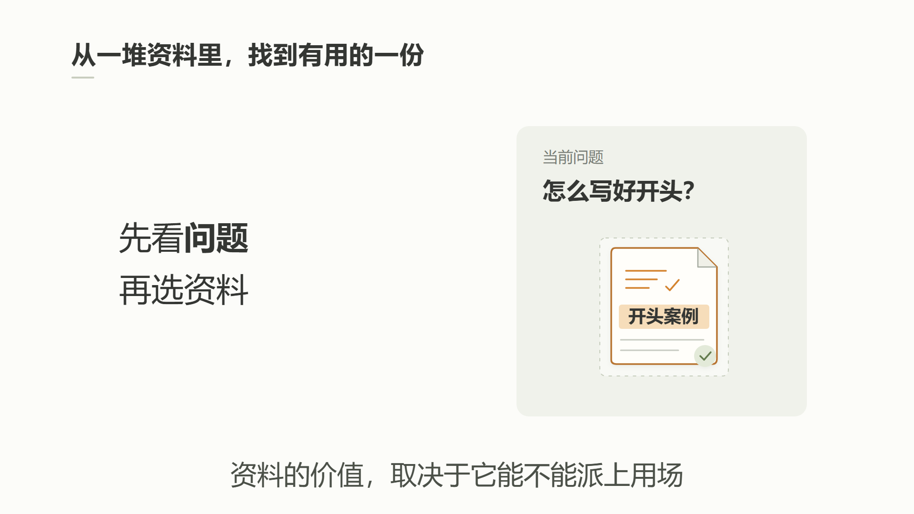

# B-roll 默认视觉：简洁二维信息图

用户于 2026-11-06 采用本版作为当前 B-roll 默认方向。参考 baoyu-infographic 的“信息布局 × 视觉风格”设计方法，具体呈现以本版确认图为准；已有项目明确指定其他风格时沿用项目选择。

## 当前视觉参考

制作前查看两张参考图。它们限定层级、留白、线条和强调方式，不限定知识内容、纸张造型、左右构图或筛选主题。先判断本镜是比较、流程、筛选、因果还是拆解，再组织相应布局。保留定稿内容与讲解逻辑，避免为了美化改写事实。

## 信息层级与焦点

- 保持简洁的二维知识讲解风格；标题、分区说明、对象标签和字幕建立清楚层级，不把所有文字都做成大号粗体。
- 同一时刻突出一个主要知识对象或关系。未被讲解的对象以中性色承托；强调色随讲解焦点转移，不为每张卡、每个标签分配鲜艳颜色。
- 先明确阅读顺序，再调整间距与对齐。保留对象之间、内容与字幕之间的空白；留白不能把属于同一语义组的短句拉散。
- 图形细节帮助识别对象，不添加无意义的装饰。轮廓清楚但轻，避免重边框、整排彩色底条和每块都加深阴影。
- 与当前 A-roll 保持相近的明度、温度、对象语汇及简化程度；B-roll 为信息阅读降低装饰密度，不机械复制人物场景的粗轮廓。

## 当前色板与字体起点

| 作用 | 色值 / 起点 | 使用方式 |
|---|---|---|
| 背景 | `#FCFCF9` | 近白，安静、不透明 |
| 主文字 | `#343633` | 标题与正文 |
| 次要说明 | `#797E77` | 辅助层级，需在实际尺寸可读 |
| 轻轮廓 | `#A5AA9F`、`#C8CBC2` | 对象边界及示意笔画 |
| 容器 | `#F0F2EB` | 柔和灰绿，按需区分区域 |
| 纸张 | `#FFFEFA` | 奶白，与背景轻微区分 |
| 强调 | `#D48430`、浅底 `#F6DDBA` | 仅用于当镜关键对象或关系 |

保持平面感。允许少量帮助辨认浮起、归位的轻阴影，不使用霓虹、强发光或宣传片式厚重材质。真实品牌、截图和证据保留自身颜色与事实内容，不为了配色重新涂改。

1920×1080 测试采用 Microsoft YaHei：标题52px、分区说明32px、对象标签37px、底部讲解56px。它们是已验证的起点，不是所有镜头的固定值；按文字长度、观看尺寸和实际字形调整。其他平台使用可用的清晰中文字体，不强制手写字体。字幕语义、时间和单行规则仍按字幕接口执行。

## 能力分工

- **baoyu-infographic：画面组织与视觉设计方法。** 按内容选布局，按当前确认图控制风格。本地未单独安装该 Skill 时，不声称已经调用完整流程；本规范足以执行已采用的视频视觉方向。若任务是生成静态信息图，再读取并执行其当前生成规范。
- **video-shotcraft：动效。** 根据知识关系选镜头卡，经 Gallery 索引校验后读取卡片全文和准确 demo；适配到本版视觉，保留关键缓动、动作逻辑、落位与停留。测试用过 type-and-filter，但其他镜头不固定套该卡。不把产品宣传片皮肤或强鼓点变为默认。
- **sound：音效检索与选材。** 画面事件基本确定后，按材质、力度、长度搜索 Freesound；混音由主流程负责，详见[声音后期](audio-postproduction.md)。

原文、语义、真实配音锚点和用户明确要求优先。静态图生成、可编辑动画、字幕和声音分别处理；不把整张信息图的缩放当作对象联动。

## 箭头、文字与同组间距

- 修复重叠时保留已选视觉语言、颜色和笔触，不擅自改成直角汇流线或另一套图表风格。
- 多条箭头指向同一对象时，各自保留可辨认的箭头尖端；调整弧度和落点，使尖端错开、箭身不相交，也不触碰目标文字。两条箭头可上下分开，三条可采用上弧线、中间直线、下弧线；不把多个尖端堆在同一点。
- 目标文字放在箭头尖端右侧，与中间箭头或各落点的视觉中心水平对齐。明确文本框高度、行高和垂直对齐，再根据实际字形微调；不能只凭文本框 top 数值判断对齐。
- 连续步骤、加法条件等属于一个语义组，优先居中配合适度 gap；不要用横跨整幅画面的 space-between 把短句拉散。间距按实际字宽与字号确定，同时保留符号两侧的呼吸空间。
- 用户截图中的“间隔太长”若指画面距离，调整布局；除非用户明确指出播放停顿，否则保留配音、字幕和出现时间。
- 中心对象连接多个平台时，平台按左右分列、同侧分行对齐；每条线在中心框上有自己的落点。线止于文字外侧留白，不能穿字、交叉或挤在一个节点上。先检查完整布局，再按口播依次出现；无方向含义的连接线不强加箭头。

## 真实品牌标识

讲到具体平台且需要观众识别时，优先从品牌官网、官方品牌资料或开发者发布的应用商店页面取得真实标识。不要用杯子、芯片等泛化图标代替淘宝闪购、京东这类具体品牌。泛化图标仍可表示“外卖”“计算”等抽象类别。

保留标识原色、比例与辨识细节；选择适合当前内容的常规标识，避免无关节日营销图。查看实际文件，确认品牌及版本，记录来源、获取日期和文件哈希。无法取得可靠素材时使用准确的平台名称，不用生图仿制商标或把非官方图称为官方标识。

## 股价与走势动画

讲述股价或指数变化时，优先采用逐步绘制的折线和移动端点，按被讲解对象的真实口播锚点依次出现，并留出看清结果的时间。多个对象可用并列小图，标题、图线、说明和字幕分别布局；不只放向上箭头代替变化过程。

展示真实行情时使用可追溯数据并注明时段和单位，保留原始数据与来源。只有方向信息时可以画概念折线，但必须明确“走势示意”，不伪造价位、日期、涨幅刻度或让折点冒充历史交易数据。这是避免误认数据的必要限定，不属于默认隐藏的制作说明。原稿数字与核查结果不符时记录差异，不能用图表强化未经证实的数字。

## B-roll 讲解头像

当前信息图版默认以知识对象为主体，不自动添加讲解头像。用户要求或旧工程已确定保留时，执行[讲解头像规范](broll-narrator.md)，身份和配色跟随当前角色，不能遮挡内容。

## 画面中的来源与制作说明

本用户工作流默认不在视频或封面中显示额外的素材来源、网址、出处人名及“官方演示截帧”“流程示意，不是真实截图”等制作说明。来源、许可与核验记录保存在项目素材清单，不自动排到画面底部。使用模板时检查 note 等字段的资产默认值及最终时间轴实例覆盖，避免导出时重新出现。

定稿本身的“Apptopia 估算”“用户自述”等限定语仍是正文内容，应保留其准确含义；不将去掉素材来源说明扩大为删改旁白、字幕或事实限定。用户另有明确展示要求时按本次要求执行。

## 与视频流程的连接

A-roll 沿用当前已确认人物和完整图片定帧方式。B-roll 按本规范排版，再按[元素与动作接口](broll-editable.md)拆分可编辑内容、绑定实际口播锚点，并用 Shotcraft 适配运动。默认 Remotion；明确续做 ChatCut 才使用其 MG。

参考测试为14秒、无旁白的风格样片，用户采用的是视觉方向，不是所有未来镜头的时间参数。正式制作仍检查逐项出现、动作过程、落位、字幕与真实声音；静态检查不等于连续播放或听审。

设计方法来源：[baoyu-infographic 官方入口](https://github.com/JimLiu/baoyu-skills/blob/main/skills/baoyu-infographic/SKILL.md)。本版是用户确认的可编辑视频适配规范，不宣称完整执行其静态栅格信息图生成流程。
